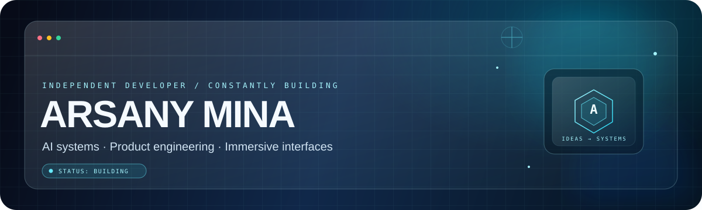

  

---

## ABOUT

### Curious by default. Builder by choice.

I’m **Arsany Mina**, a developer exploring the intersection of **AI, product engineering, and immersive design**.

I build practical tools and ambitious experiments — from AI-agent workflows and modern web experiences to Android applications and Arabic-first platforms. My process is simple: understand the problem, shape the experience, engineer the system, and keep refining the details.

Currently interested in: agentic workflows · browser-side AI · useful products · interfaces with personality

<table>
<tr>
<td width="33%" valign="top">

### ◇ AI & AGENTS

Agent workflows, browser-side inference, tool use, project memory, and automation.

</td>
<td width="34%" valign="top">

### ◇ PRODUCT ENGINEERING

Useful applications, data flows, backend integration, native Android, and real-world workflows.

</td>
<td width="33%" valign="top">

### ◇ INTERACTION DESIGN

Glass-inspired interfaces, motion, clear information hierarchy, and responsive experiences.

</td>
</tr>
</table>

---

## SELECTED WORK

A selected snapshot of what I’m exploring. Open any project to inspect the code and current state.

<table>
<tr>
<td width="50%" valign="top">

### 01 / WIP Brain

**Browser-side website-building agent**

An ambitious AI-agent experiment built around planning, project memory, structured site edits, validation, QA, and repair — with model inference explored directly in the browser.

**Focus:** AI agents · WebGPU/WebLLM · Web engineering

</td>
<td width="50%" valign="top">

### 02 / MediFind

**Nearby-pharmacy discovery**

A map-led discovery interface combining browser location, nearby results, a selected-place detail view, and direction-oriented workflows.

**Focus:** React · TypeScript · Leaflet · Geolocation

</td>
</tr>
<tr>
<td width="50%" valign="top">

### 03 / Dr. Mirna Ayoub

**Physical therapy & dietary coaching**

A service website presenting physical therapy and dietary support, including calorie-calculation and daily meal-plan workflows.

**Focus:** Service design · Health tools · Responsive UI

</td>
<td width="50%" valign="top">

### 04 / The Website That Watches You Back

**Interaction-driven web experiment**

A procedural experience that turns on-page interaction patterns into a digital specimen, with a reveal sequence, repeatable sessions, responsive layout, and reduced-motion support.

**Focus:** Next.js · Interaction design · Procedural UI

</td>
</tr>
<tr>
<td width="50%" valign="top">

### 05 / Surprise Microsite

**Personalized interactive experience**

A reveal-led web experience built around playful motion and a memorable moment designed to feel custom rather than template-made.

**Focus:** Interactive UI · Motion design · Responsive web

</td>
<td width="50%" valign="top">

### 06 / Bulls Art Studio

**Creative studio web experience**

A brand-led web experience for the Bulls Art identity, focused on strong visual presentation, modern interface design, and motion-minded storytelling.

**Focus:** Web design · Branding · Digital experience

[Visit Bulls Art ↗](https://www.bulls-art.com/)

</td>
</tr>
</table>

---

## LIVE PROJECT FEED

Automatically refreshed by GitHub Actions every Monday, or manually from the Actions tab.

<!-- LIVE-PROJECTS:START -->
| # | Repository | Signal | Primary language | Last pushed |
|:--:|---|---|---|:---:|
| 01 | [**surprise**](https://github.com/arsanygeniusmina-star/surprise) | A separate surprise project based on the original Mariam Surprise codebase. | TypeScript | 2026-10-05 |
| 02 | [**try**](https://github.com/arsanygeniusmina-star/try) | A project in progress. | TypeScript | 2026-09-26 |
| 03 | [**0AHFIEWF0F**](https://github.com/arsanygeniusmina-star/0AHFIEWF0F) | A project in progress. | Exploration | 2026-09-20 |
| 04 | [**desktop-jarvis**](https://github.com/arsanygeniusmina-star/desktop-jarvis) | A project in progress. | TypeScript | 2026-09-19 |
| 05 | [**Mariam-Surprise**](https://github.com/arsanygeniusmina-star/Mariam-Surprise) | A project in progress. | TypeScript | 2026-09-14 |
| 06 | [**Bullsartstudio1**](https://github.com/arsanygeniusmina-star/Bullsartstudio1) | A project in progress. | TypeScript | 2026-09-10 |

[Browse every repository →](https://github.com/arsanygeniusmina-star?tab=repositories)
<!-- LIVE-PROJECTS:END -->

Last refreshed: <!-- LAST-UPDATED:START -->
2026-10-12 15:44 UTC
<!-- LAST-UPDATED:END -->

---

## TOOLKIT

LANGUAGES & UI

PLATFORMS & WORKFLOW

---

## GITHUB SIGNALS

Live widgets may take a moment to load. Stats reflect public GitHub activity and can vary by provider.

  

---

## THE BUILDING PRINCIPLE

**Make it useful. Make it clear. Make it feel different.**

Good software is more than a screenshot. It combines a clear purpose, thoughtful engineering, and details that make the experience feel effortless. I’m here to keep learning, experimenting, and shipping better ideas.

  

ARSANY MINA · CREATIVE DEVELOPER · WORK IN PROGRESS, BY DESIGN

